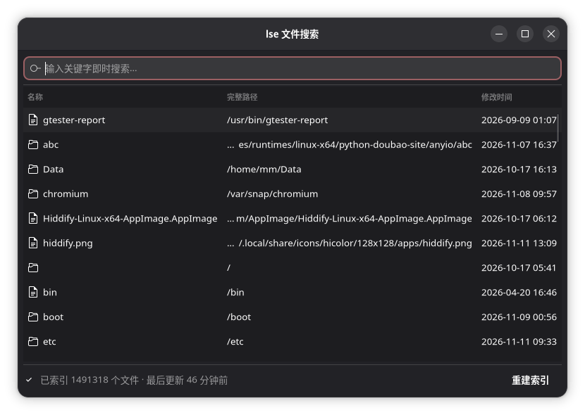

# lse

Linux 桌面文件搜索工具：输入关键字即时搜索本机文件。Rust 编写，含图形界面、命令行和后台索引服务。

> **本项目完全由 AI 开发并发布，未经过充分验证，不保证后续更新，可能存在未知问题。**
>
> 感谢参与开发的模型：小米 MiMo 2.6 Flash、通义千问 Qwen3.8 Flash，及其他协作模型。

## 下载

见 [Releases](https://github.com/BeerenBoheme/lse/releases)（含 .deb、AppImage、源码包与校验和）。

## 构建

需要 Rust 与 GTK4 相关开发库；`make release` 生成全部发布产物到 `dist/`。细节见 `Makefile`。

## 免责声明

本项目代码与发布内容均为 AI 生成，不保证正确性与稳定性，不保证后续更新，使用风险自负。
